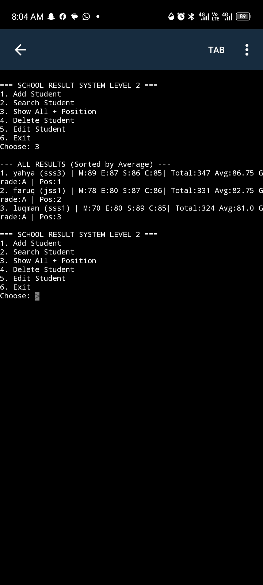

🎓 School Result System - Level 2

A simple and efficient CLI-based School Result Management System built with Python and SQLite.

This is Level 2 of my school project, with database persistence and ranking features.

✨ Features
- ➕ Add Student with class, Maths, English, Science, Computer scores
- 🔍 Search Student by name
- 📊 Show All Students with automatic Position / Ranking
- ❌ Delete Student
- ✏️ Edit Student record
- 🧮 Auto-calculates Total, Average, and Grade (A, B, C...)

🛠️ Tech Stack
- Python 3
- SQLite3
- Pydroid 3 (Android)

📸 Demo
Added yahya | Total:347 Avg:86.75 Grade:A


🚀 How to Run
```bash
python main.py
👨‍💻 Author
Yahya Dawud - Learning Python & Building Projects

📌 Level 2 Improvements
- Fixed SQLite bug: table results has no column named class
- Renamed reserved keyword class to student_class
- Added proper error handling and position ranking

---
⭐ Star this repo if you like it.
